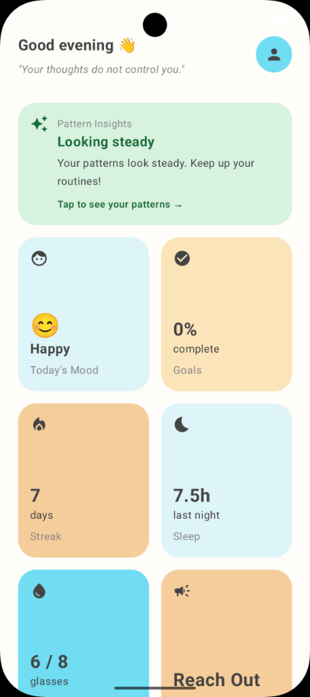
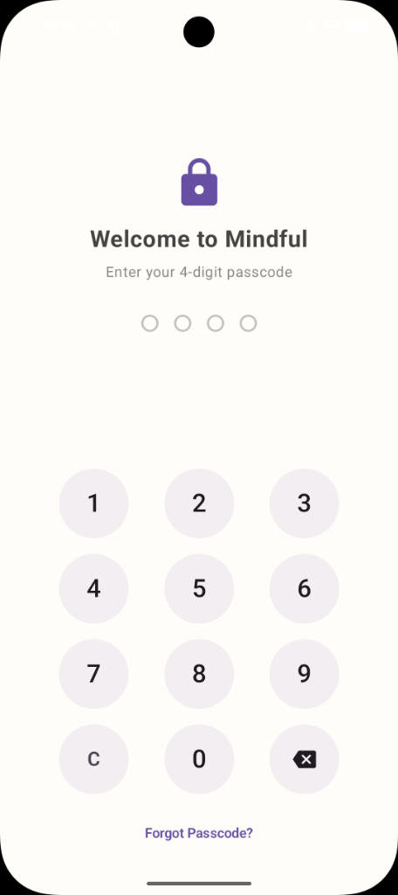
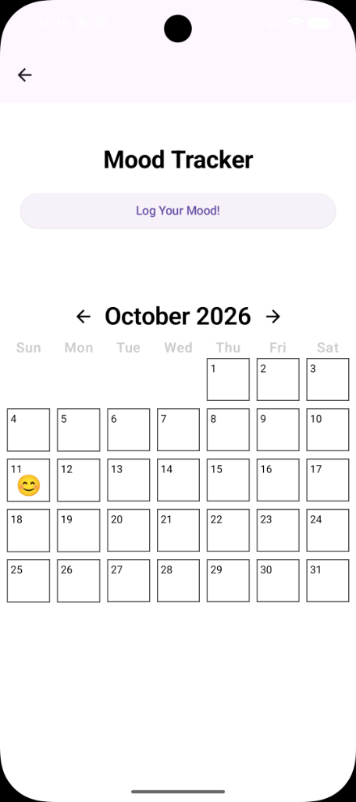
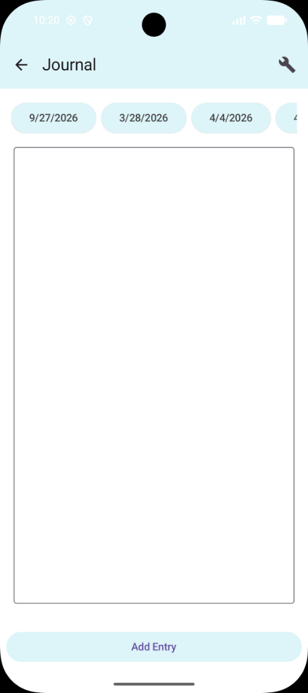
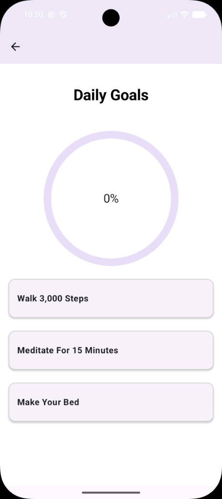
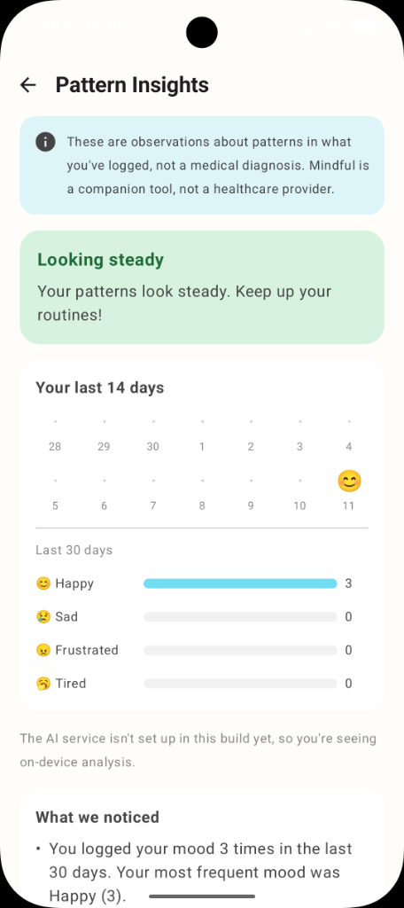

# Mindful – User Manual

**Version:** 1.0  
**Team Name:** Mind Matters  
**Date:** 10/11/26  

---

## 1. Introduction

Mindful is an android application made for tracking your mood, thoughts, and goals in order for it to be analyzed by an integrated AI agent to give suggestions about seeking our help. This app is designed for everyone who is looking to track their mental health journey, and it is designed for them to be able to find mental health resources easily.

---

## 2. System Requirements

* **Hardware:**
  * **Device:** Android device
  * **RAM:** Minimum 2GB Ram
  * **Storage:** Minimum 100mb available local storage
  * **Internet connection:** Optional. Mindful operates fully offline for all core features, but with internet connection users gain access to AI insight.
* **Software:** Android 8.0 [API 26] or higher
* **Other Dependencies:**
  * Java Development kit: JDK17 / 21
  * Android Studio

---

## 3. Installation Guide

**Installing on an Android Device or Emulator via Android Studio**

1. **Clone the Repository:**
   ```bash
   git clone https://github.com/Jake-Moseley/Mindful.git
   ```
2. **Open the Project:** Launch Android Studio, click **File** then **Open**, and select the `Mindful` directory.
3. **Sync Gradle:** Allow Gradle to sync automatically, a popup at the top of your screen should be seen and click sync.
4. **Connect Device / Emulator:** Start an android virtual device from the device manager or plug in a physical Android phone with USB debugging enabled.
5. **Run the Application:** Click the green **Run** button on the top toolbar.

---

## 4. Getting Started

1. **Launch the Application**
   * Tap on the Mindful app icon on your device home screen or app drawer.
2. **First time Security Opt-in**
   * Upon first launch, Mindful presents a privacy dialog.
   * Select “Set up Passcode” to create an optional 4-digit pin, or choose “Skip for now”.
     * **If setting up a passcode:**
       1. Select a recovery security question and enter an answer.
       2. Enter your desired pin using the on-screen number pad.
       3. Re-enter the pin to confirm the code.
3. **Navigating the app:**
   * After the initial setup you will now be taken to the home page where you will be greeted based on the time of day as well as a quote to keep you moving.
   * The landing page offers access to all of what Mindful has to offer, this is where and how you will navigate to the journal, mood logging, analysis, and more.

<p align="center">
  <br>
  <em>Figure 1: Mindful Home Dashboard</em>
</p>

---

## 5. Features & Functions

### Feature 1: Privacy Lock & Passcode Protection

* **Description:** Protects sensitive reflections and mood logs. The PIN and security answer are locally encrypted using SHA-256 cryptographic hashing with a device unique salt.

<p align="center">
  <br>
  <em>Figure 2: Passcode Lock Screen & Keypad</em>
</p>

---

### Feature 2: Daily Mood Tracker

* **Description:** Lets you log how you feel each day and see your mood history across a monthly calendar.
* **How it works:**
  * Tap the mood widget.
  * Select your mood, user can change if miss logged for the day.
  * View your past logged moods on the monthly calendar.

<p align="center">
  <br>
  <em>Figure 3: Daily Mood Tracker & Calendar View</em>
</p>

---

### Feature 3: Daily Journal

* **Description:** A private space to write notes, reflect on your day, and look back at previous entries.
* **How it works:**
  * Tap the Journal Widget on the Home Screen.
  * Tap “Add entry” and write today's reflection.
  * Tap “Complete Entry” when you are finished to save it.
  * Use the date scroll bar to view old entries.

<p align="center">
  <br>
  <em>Figure 4: Daily Journal Entry & Date Carousel</em>
</p>

---

### Feature 4: Goals Tracker

* **Description:** Helps you keep track of daily wellness habits and routines.
* **How to use it:**
  * Tap on the “Goals” widget.
  * Check off tasks as you finish them during the day.
  * Track your daily completion percentage on the dashboard.

<p align="center">
  <br>
  <em>Figure 5: Daily Goals Screen & Habit Checklist</em>
</p>

---

### Feature 5: Pattern Insight

* **Description:** Looks at your recent mood logs and other mood data to identify wellness trends and provides helpful mental health resources.
* **How to use it:**
  * Tap “Pattern insight” at the top of the screen.
  * Opt in to pattern analysis.
  * View pattern trends over time, note that this takes a few days to begin giving results, the more you use the app, the more data the analysis has to run off of.

<p align="center">
  <br>
  <em>Figure 6: Pattern Insights Summary & Trend Breakdown</em>
</p>

---

## 6. Troubleshooting Examples

| Problem | Cause | Solution |
| :--- | :--- | :--- |
| **Forgot passcode** | User cannot remember pin | Tap "Forgot passcode" and answer your recovery question |
| **Passcode prompt did not appear** | Skipped during initial setup | Tap the cyan icon in the top of the home screen and enable passcode |
| **Emulator won't start or crashes** | Android studio vm device may be corrupt | In Android studio, open Device Manager click the three dots next to the emulator, and select "Cold boot" |
| **Past journal entry not appearing** | Date was not selected | Scroll horizontally across the top date pills in the journal screen and tap the specific date |

---

## 7. Contact Information

* **Support Email:** N/A (Don't have an email at this time)
* **Website:** [Optional]
* **Project Repository:** [https://github.com/Jake-Moseley/Mindful.git](https://github.com/Jake-Moseley/Mindful.git)
* **Other Support Channels:** [Optional]

---

## 8. FAQ (Optional – Extra Credit)

**Q: What is Mindful?**  
**A:** Mindful is a mental health companion application that tracks your daily mood, write journal entries, set goals, find mental health professionals, and view AI Insights to notice your mood patterns. It’s a self-care tool to help you keep track of your mental health better, not a replacement for professional help.

**Q: How do I know my information is safe?**  
**A:** Mindful is designed to keep your information safe by storing your data on your phone. Each entry is locally stored and does not upload to any servers. AI Insights may share some data, only if you allow it. Even then, it only sends short summaries of your mood, and does not share any more.

**Q: How do I log my mood?**  
**A:** On the home screen, tap the “Today’s Mood” widget, then tap “Log Your Mood!”. Pick the mood that most accurately describes how you feel that day. Your mood will appear in the calendar, and on the home screen widget.

**Q: How does the journal work?**  
**A:** Open the journal and tap “Add Entry” to start journaling. Your writing will save automatically, even if you leave the application or page. Once finished, click “Complete Entry”, and your journal entry will enter a read-only state. You can then view past journal entries by clicking different date widgets at the top.

**Q: How do I complete goals?**  
**A:** Tap the goals widget on the home screen, then tap the goal to mark it complete. Your progress bar will then update on the goals and home page.

**Q: What is Pattern Insights?**  
**A:** The pattern insights will look at your past moods, journal entries, and goals to spot patterns, such as tough weeks, recurring moods, or a significant change in mood. It will then give suggestions that may help. You can click the top card on the home screen to view it.

**Q: Is Pattern Insights a diagnosis?**  
**A:** No, the pattern insights feature is simply an observation that makes small suggestions. It does not diagnose or give any medical advice.

**Q: Does the app work without internet?**  
**A:** Yes, all features will work without internet except for the AI Insights.

**Q: Why does Pattern Insights say it needs more data?**  
**A:** Pattern Insights needs a few days worth of information to find a pattern and give accurate data. Log your mood daily, write journal entries, and you will see insights appear.
